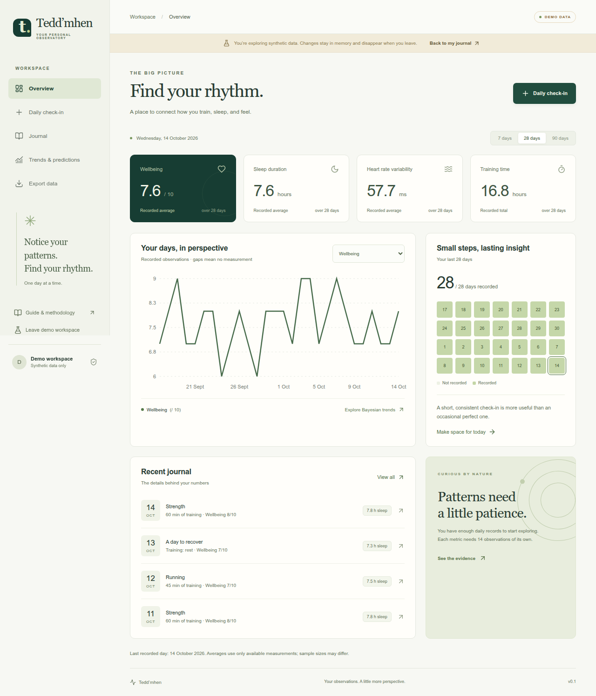

# Tedd’mhen

A personal training and recovery journal with structured health metrics, Bayesian trend analysis, and flexible data exports for external AI analysis. Built for Cloudflare with privacy-first access.

Tedd’mhen helps you record how you train, sleep, and feel, then explore your own longitudinal data. Subjective experiences use explicitly anchored numeric scales; free-text notes provide optional context. The application does not call an LLM or transmit your records to an AI provider.

**Status:** functional v0.1 application with automated validation. Deployment requires your own Cloudflare configuration. The statistical model is exploratory; computational tests do not establish clinical validity or forecasting calibration.



## Features

- **Overview:** recent observations, recording consistency, training volume, and sleep / wellbeing charts.
- **Daily check-in:** wellbeing, energy, motivation, fatigue, stress, soreness, illness severity, symptom severity, sleep timing and duration, sleep ratings, HRV, respiratory rate, resting heart rate, and training sessions.
- **Training:** running, strength, cycling, swimming, walking, mobility, and other activities; duration, distance, perceived effort, pain, and strength sets.
- **Journal:** date and activity filters, illness filters, text search, pagination, editing, and deletion with revision checks.
- **Bayesian trends:** exact conjugate linear regression, explicit priors, 95% credible and predictive intervals, short extrapolations, missing-data handling, and model diagnostics.
- **Selective export:** JSON, NDJSON, CSV, and Markdown with selectable data groups. JSON, NDJSON, and Markdown include metadata and a data dictionary. Optional notes are excluded unless selected.
- **Private by design:** verified Cloudflare Access identity, owner-scoped queries, no analytics trackers, no third-party fonts, and no real records in the repository.

## Stack

TypeScript · React · Vite · Cloudflare Workers Static Assets · Cloudflare D1 (SQLite) · Cloudflare Access · Recharts · Zod · Vitest · Playwright.

The public source repository is separate from your private deployment and database. One person can use the application without an application-level account administration screen. Data ownership already supports multiple Access identities, with no sharing between them.

## Local development

Use Node.js 22.12+ (or a supported newer LTS) and npm.

```sh
npm ci
npm run setup
npm run dev
```

Open `http://127.0.0.1:5173`. The API runs at `http://127.0.0.1:8787`. Setup applies local D1 migrations and creates an ignored `.dev.vars` containing `LOCAL_DEV=true`. Authentication bypass requires both this flag and a loopback request hostname. It must never be used in a deployed environment.

Local data lives in ignored `.wrangler/` state. The optional demo contains synthetic records, runs in memory, and never writes them into D1.

```sh
npm run typecheck
npm test
npm run build
npx playwright install chromium
npm run test:e2e
```

## Deploy to your Cloudflare account

Follow [the deployment guide](docs/DEPLOYMENT.md) to provision D1, protect a custom domain with Cloudflare Access, configure the Worker, apply migrations, and deploy. No Cloudflare credentials are stored in source. Production API access fails closed until Access configuration is present and a valid token is supplied.

## Data and analysis

Read the [data dictionary](docs/DATA_DICTIONARY.md), [statistical methodology](docs/METHODOLOGY.md), and [architecture notes](docs/ARCHITECTURE.md).

- Missing values stay `null`; they are never silently converted to zero.
- A day of rest must be explicitly recorded. Missing effort makes training load unknown.
- Sleep belongs to the date you wake up. Sleep duration is entered independently from time in bed.
- Rating anchors are project-defined and must be used consistently; they are not validated clinical instruments.
- Results describe within-person observations under model assumptions. They are not diagnoses, causal effects, or treatment recommendations.
- Wearable scores and HRV methods are not interchangeable across sources.

Long narratives are stored in D1 but excluded from list and analysis payloads. Daily request bodies are capped at 256 KiB, individual notes at 50,000 characters. Exports stream rows in batches and accept up to 1,831 calendar days per request. D1 has finite storage and plan quotas; see the deployment guide before assuming unlimited capacity. Attachments and an R2 archive tier are not implemented.

## Repository practices

Changes must pass type checks, statistical / validation tests, a production build, and browser checks. Keep real health data, database exports, credentials, and local state out of issues, commits, screenshots, and CI artifacts. See [CONTRIBUTING.md](CONTRIBUTING.md) and [SECURITY.md](SECURITY.md).

No license has been selected yet. Public visibility alone does not grant an open-source license.
