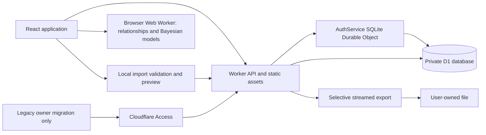

# Architecture

The application is a React SPA served with Cloudflare Workers Static Assets. `/api` and `/api/*` always invoke the Worker, including browser navigation requests. Other routes use SPA fallback. Development uses a Vite server proxying `/api` to a local Wrangler instance; a production build can be tested directly with `npm run preview`.

## Responsibilities

| Location                                                                | Responsibility                                                                      |
| ----------------------------------------------------------------------- | ----------------------------------------------------------------------------------- |
| `shared/schema.ts`                                                      | Strict input schema, rating definitions, dates, summaries                           |
| `shared/metrics.ts`                                                     | Numeric metric accessors, fixed model scaling, physical bounds                      |
| `shared/bayes.ts`, `shared/multivariable.ts`                            | Single and multiple-input conjugate Bayesian regression                             |
| `shared/features.ts`, `shared/relationships.ts`, `shared/statistics.ts` | Feature encoding, calendar alignment, correlations, bootstrap and linear algebra    |
| `shared/import.ts`                                                      | Bounded JSON/NDJSON/CSV parsing, selective merge and validation                     |
| `shared/export.ts`                                                      | Field selection, dictionary, CSV escaping, Markdown formatting                      |
| `worker/auth.ts`                                                        | Application session verification, legacy Access JWT verification, local mode        |
| `worker/index.ts`                                                       | Ownership, API, validation, queries, streaming exports                              |
| `worker/admin.ts`                                                       | Explicit role checks and aggregate administration queries                           |
| `src/pages/`                                                            | Journal, analysis, import/export, account, administration, help, privacy and author |
| `migrations/`                                                           | Versioned D1 schema migrations                                                      |
| `tests/`                                                                | Statistical, schema, export, security, SQLite-backed API and browser tests          |

## Storage model

`users.id` is a random account UUID, or the unchanged verified Access subject for a migrated legacy owner. `entries` has a composite primary key `(owner_id, date)`, JSON-validated versioned data, an optimistic revision number, and UTC creation/update timestamps. One daily document contains its ratings, sleep, physiology, symptoms, workouts, strength sets, and optional narratives. Repeated workout items have stable UUIDs. This avoids losing relationships when exporting a day and accommodates long narratives without duplicating them across tables.

The owner/date key provides date-range access. Journal text search uses `instr(lower(data), lower(?))` over the selected owner/date window, including text and structured JSON values; it is a substring scan, not full-text semantic search. SQLite’s default lowercase matching is primarily ASCII. Narrow date filters reduce work. There is no semantic or full-text search index.

List and analysis responses use SQL projections that remove narratives and workout details. This keeps long-form content out of dashboard payloads. Detail requests load one day. Exports fetch full records in batches of 50 and apply the chosen fields before serializing.

Each daily JSON request is limited to 256 KiB, each narrative to 50,000 characters, and each day to 20 sessions. This is a bounded large-text journal, not unlimited object storage. D1’s database limits remain authoritative; large attachments and archival R2 storage are not implemented.

## API

| Method and path                        | Behavior                                                                     |
| -------------------------------------- | ---------------------------------------------------------------------------- |
| `GET /api/health`                      | Public liveness only; does not claim database readiness                      |
| `GET /api/session`                     | Verified ID, email, local-mode and administrator status                      |
| `GET /api/entries`                     | Owner-scoped summaries, total, date cursor; default 30, maximum 100 rows     |
| `GET /api/entries/:date`               | One complete daily record, or 404                                            |
| `PUT /api/entries/:date`               | `{ entry, revision }`; revision 0 creates, current revision updates          |
| `DELETE /api/entries/:date?revision=N` | Delete only when the revision matches                                        |
| `GET /api/series?from=...&to=...`      | Lightweight observations; range span at most 1,830 days                      |
| `GET /api/series?all=true`             | All owner observations, at most 10,000 days; larger requests fail explicitly |
| `GET /api/admin/overview`              | Aggregate operational statistics, explicit administrator role required       |
| `GET /api/export`                      | Stream selected records as JSON, NDJSON, CSV, or Markdown                    |

List, series, and export filters accept `from`, `to`, `q`, `type`, and `illness`. `illness=no` includes only explicitly zero severity; unknown is not treated as well. `illness=yes` includes positive severity or recorded symptoms. UI journal exposes all filters; analysis exposes dates/all history, illness, source, HRV method, training status and labels; export exposes date and field selection.

An export accepts `format`, comma-separated `groups`, and optional comma-separated `fields`. Metadata always includes date, time zone, schema version, revision and timestamps. JSON, NDJSON and Markdown additionally include a dictionary. CSV formula-like strings are apostrophe-prefixed, so CSV is not a byte-exact archival format. Prefer JSON for preservation.

Export count and batches are separate queries, not a transactional snapshot. Avoid editing entries while exporting. Stream interruption fails the download; a partial file must not be used as a complete backup. File System Access-capable browsers stream to disk; other browsers have a 64 MiB buffered-download cap. Select a shorter time window if needed.

## Analysis and import execution

Relationships and multivariable predictions run in a dedicated browser Web Worker. Changing inputs terminates the previous job; obsolete results cannot replace a newer selection. Only lightweight observations are fetched. Filters define the eligible calendar before pairing and model fitting. Notes are excluded from analysis; encoded labels provide structured context. Downloaded model reports preserve design rows, scaling, priors, posterior parameters and validation settings. See [Methodology](METHODOLOGY.md).

Imports parse and validate files locally before confirmation. They reuse the owner-scoped entry API, one day per optimistic revision check. `X-Teddmhen-Expected-User` binds the import destination to the account previewed by the browser; an account change rejects the request. Omitted values remain unchanged in merge mode; skip mode leaves existing days untouched. Interrupted imports can partially complete. See [Import and export](IMPORT_EXPORT.md).

`administrators` grants roles by immutable user ID. The API checks the role independently on every administrator request. Registration cannot assign roles, and an email match cannot create a grant. Aggregate byte volume measures stored journal JSON, not the total D1 file or billing usage. See [Administration](ADMINISTRATION.md).

## Failure handling

Mutation conflicts return 409 and keep the user’s current form visible. Validation errors return 400, oversized bodies 413, and non-JSON writes 415. Unknown routes return 404 JSON instead of the SPA shell. Unexpected errors return a generic 500; server logs exclude payloads and query strings. API responses use `private, no-store`.

Public accounts are isolated. Explicit administrator grants provide aggregate operational statistics. Invitations, email delivery, MFA, and shared records are not implemented. The demo is explicit, synthetic, and held in memory; leaving or reloading discards it.

## Authentication and migration

`auth_accounts` stores unique normalized email identifiers, versioned scrypt hashes, hashed recovery codes, and a credential version. `auth_sessions` stores only SHA-256 digests of 256-bit random session tokens, expiry timestamps, and the account version. Reads join on the current version and expiry; recovery/password changes invalidate every previous session atomically. Production cookies are `__Host-teddmhen_session; Secure; HttpOnly; SameSite=Lax; Path=/`, with a seven-day lifetime. Session rows expire independently of browser cookies.

Credential work runs in one `AuthService` SQLite Durable Object, whose CPU allowance supports scrypt N=32768, r=8, p=3, with a 128-bit random salt and 64-byte derived hash. Journal reads and writes stay in the Worker/D1 path. The object maintains persistent ten-minute attempt counters (30 per IP, 10 per normalized email for login/recovery). It stores digests rather than clear-text limiter identifiers, cleans expired counters on subsequent requests, and never logs credentials. This single-object design is appropriate to the pilot; measure throughput before scaling it.

All credential endpoints accept same-origin JSON POSTs with `X-Teddmhen-Request: 1`, bounded to 8 KiB:

| Path under `/api/auth/` | Input / effect                                                                      |
| ----------------------- | ----------------------------------------------------------------------------------- |
| `register`              | `{email,password}`; creates account/session and returns recovery code once          |
| `login`                 | `{email,password}`; creates a session                                               |
| `recover`               | `{email,password,code}`; consumes one code, rotates credentials, creates session    |
| `logout`                | `{}`; deletes the current session and clears the cookie                             |
| `change-password`       | `{currentPassword,password}`; requires session and rotates credentials/code         |
| `delete-account`        | `{currentPassword}`; deletes the signed-in account, sessions and journal            |
| `claim`                 | `{password}`; requires independently verified legacy Access JWT, preserves owner ID |

`GET /api/auth/claim` serves the migration UI after Access JWT verification. Only that path remains protected by the owner-only Access application. Migration 0002 reserves existing legacy emails before registration opens; a deployment may additionally reserve an allowed owner who has not yet saved any data. A mismatch between the reserved owner ID and verified subject fails closed. Client-supplied legacy identity headers are stripped and replaced only after JWT verification. Recovery codes contain 256 random bits and are single-use through a conditional update. Email is an unverified identifier, never evidence for account linking or migration.

## Browser appearance and privacy

The `AppearanceProvider` resolves manual Light/Dark or Auto. With saved approximate coordinates, SunCalc computes sunrise/sunset locally, including polar day/night. Auto without coordinates follows `prefers-color-scheme`. Changes apply before paint, at the next transition, and on focus/visibility changes. Browser-only preferences use `teddmhen.appearance.v1`; the necessary-cookie notice acknowledgement uses `teddmhen.privacy-notice.v1`. Storage denial leaves the application usable for the current page session. Geolocation is called only from an explicit button action; no coordinates enter API requests or D1.
