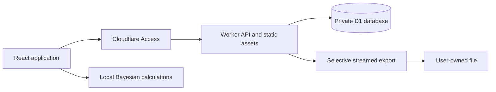

# Architecture

The application is a React SPA served with Cloudflare Workers Static Assets. `/api` and `/api/*` always invoke the Worker, including browser navigation requests. Other routes use SPA fallback. Development uses a Vite server proxying `/api` to a local Wrangler instance; a production build can be tested directly with `npm run preview`.

## Responsibilities

| Location            | Responsibility                                                             |
| ------------------- | -------------------------------------------------------------------------- |
| `shared/schema.ts`  | Strict input schema, rating definitions, dates, summaries                  |
| `shared/metrics.ts` | Numeric metric accessors, fixed model scaling, physical bounds             |
| `shared/bayes.ts`   | Exact conjugate regression and interval calculations                       |
| `shared/export.ts`  | Field selection, dictionary, CSV escaping, Markdown formatting             |
| `worker/auth.ts`    | Access JWT verification and explicit localhost development mode            |
| `worker/index.ts`   | Ownership, API, validation, queries, streaming exports                     |
| `src/pages/`        | Overview, check-in, journal, analysis, export, help                        |
| `migrations/`       | Versioned D1 schema migrations                                             |
| `tests/`            | Statistical, schema, export, security, SQLite-backed API and browser tests |

## Storage model

`users.id` is the verified Access subject. `entries` has a composite primary key `(owner_id, date)`, JSON-validated versioned data, an optimistic revision number, and UTC creation/update timestamps. One daily document contains its ratings, sleep, physiology, symptoms, workouts, strength sets, and optional narratives. Repeated workout items have stable UUIDs. This avoids losing relationships when exporting a day and accommodates long narratives without duplicating them across tables.

The owner/date key provides date-range access. Journal text search uses `instr(lower(data), lower(?))` over the selected owner/date window, including text and structured JSON values; it is a substring scan, not full-text semantic search. SQLite’s default lowercase matching is primarily ASCII. Narrow date filters reduce work. An FTS index can be added if measured workloads justify it.

List and analysis responses use SQL projections that remove narratives and workout details. This keeps long-form content out of dashboard payloads. Detail requests load one day. Exports fetch full records in batches of 50 and apply the chosen fields before serializing.

Each daily JSON request is limited to 256 KiB, each narrative to 50,000 characters, and each day to 20 sessions. This is a bounded large-text journal, not unlimited object storage. D1’s database limits remain authoritative; large attachments and archival R2 storage are not implemented.

## API

| Method and path                        | Behavior                                                                 |
| -------------------------------------- | ------------------------------------------------------------------------ |
| `GET /api/health`                      | Public liveness only; does not claim database readiness                  |
| `GET /api/session`                     | Verified session metadata                                                |
| `GET /api/entries`                     | Owner-scoped summaries, total, date cursor; default 30, maximum 100 rows |
| `GET /api/entries/:date`               | One complete daily record, or 404                                        |
| `PUT /api/entries/:date`               | `{ entry, revision }`; revision 0 creates, current revision updates      |
| `DELETE /api/entries/:date?revision=N` | Delete only when the revision matches                                    |
| `GET /api/series?from=...&to=...`      | Lightweight analytical observations; maximum span 1,830 days             |
| `GET /api/export`                      | Stream selected records as JSON, NDJSON, CSV, or Markdown                |

List, series, and export filters accept `from`, `to`, `q`, `type`, and `illness`. `illness=no` includes only explicitly zero severity; unknown is not treated as well. `illness=yes` includes positive severity or recorded symptoms. UI journal exposes all filters; analysis exposes date, illness, source and HRV method; export exposes date and field selection.

An export accepts `format`, comma-separated `groups`, and optional comma-separated `fields`. Metadata always includes date, time zone, schema version, revision and timestamps. JSON, NDJSON and Markdown additionally include a dictionary. CSV formula-like strings are apostrophe-prefixed, so CSV is not a byte-exact archival format. Prefer JSON for preservation.

Export count and batches are separate queries, not a transactional snapshot. Avoid editing entries while exporting. Stream interruption fails the download; a partial file must not be used as a complete backup. File System Access-capable browsers stream to disk; other browsers have a 64 MiB buffered-download cap. Select a shorter time window if needed.

## Failure handling

Mutation conflicts return 409 and keep the user’s current form visible. Validation errors return 400, oversized bodies 413, and non-JSON writes 415. Unknown routes return 404 JSON instead of the SPA shell. Unexpected errors return a generic 500; server logs exclude payloads and query strings. API responses use `private, no-store`.

Session ownership is prepared for multiple users, but invitations, role management, shared records, and account deletion workflows are outside this release. The demo is explicit, synthetic, and held in memory; leaving or reloading discards it.
